# State machines

Generated from `packages/db/src/state-machines.ts` by its test: run `pnpm exec vitest run packages/db/src/state-machines.test.ts -u` after changing a machine. Do not edit by hand.

Every stored status moves only by a row of its machine. Code changes a status through the machine (`transitionOrThrow`, `machine.transitions[event].to`) and guards the update with `startsFrom` (`packages/db/src/state-guard.ts`), so a stale or concurrent writer cannot skip a step or leave a final state. Checks that need more than the status (an unconfirmed send, a dispute hold) stay in the use case, before the move.

To add a status or a move: change the machine in `packages/core` (or the engine's lifecycle in `packages/oss`), then the schema enum follows from it.

## project

Owner: `packages/core/src/projects/state-machine.ts` (`transitionProject`, `allowedProjectEvents`, `projectAllows`). Guarded moves also need facts: a pending amendment, an unpaid top-up, the balance due.

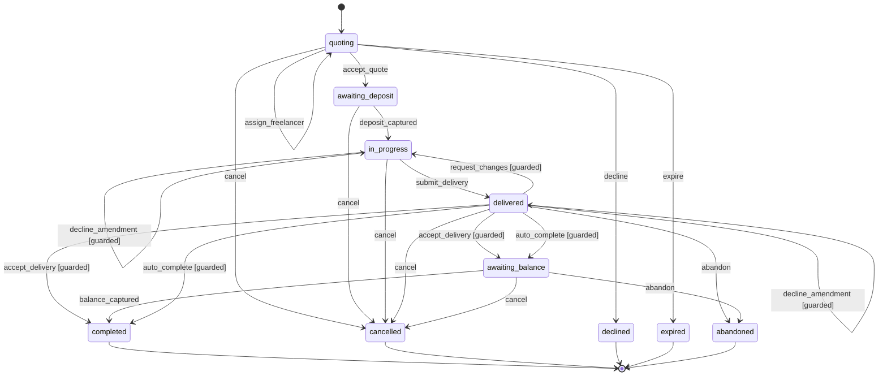

## payout_request

Table `payout_request`. Written by db/repositories/payout-requests.ts transitionPayoutRequest.

| Event | From | To |
| --- | --- | --- |
| `approve` | `requested` | `queued` |
| `reject` | `requested`, `queued` | `rejected` |
| `withdraw_approval` | `queued` | `requested` |
| `claim_send` | `queued`, `sending` | `sending` |
| `hold_send` | `sending` | `queued` |
| `record_batch` | `sending`, `queued` | `sent` |
| `refuse_send` | `sending` | `failed` |
| `export` | `queued` | `exported` |
| `cancel_export` | `exported` | `queued` |
| `settle_succeeded` | `sent`, `exported`, `queued` | `succeeded` |
| `settle_failed` | `sent`, `exported`, `queued` | `failed` |

Final: `rejected`, `succeeded`, `failed`.

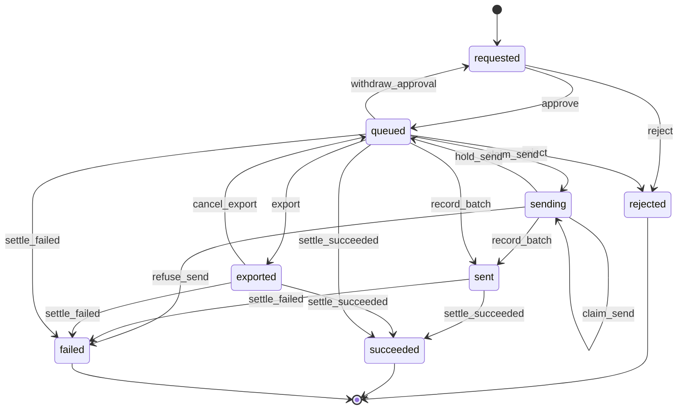

## payment

Table `payment`. Written by api/use-cases/payments.ts, db/repositories/projects.ts addPaymentRefunded.

| Event | From | To |
| --- | --- | --- |
| `start_order` | `pending`, `failed` | `pending` |
| `capture_completed` | `pending`, `failed` | `captured` |
| `capture_failed` | `pending`, `failed` | `failed` |
| `refund_in_full` | `captured` | `refunded` |
| `cancel` | `pending`, `failed` | `cancelled` |

Final: `cancelled`, `refunded`.

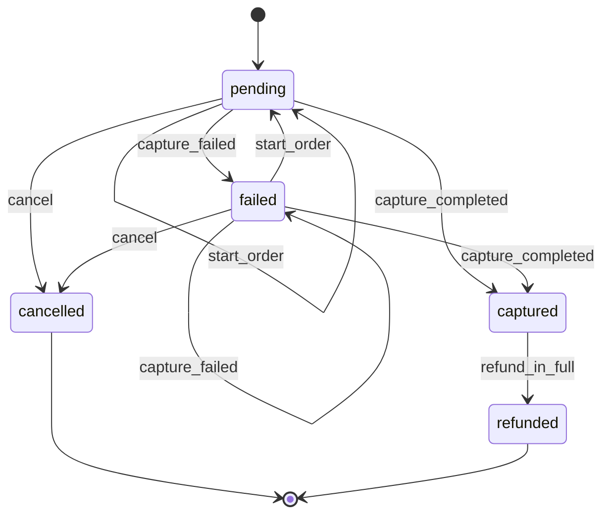

## project_refund

Table `project_refund`. Written by db/repositories/project-refunds.ts.

| Event | From | To |
| --- | --- | --- |
| `issue` | `requested`, `issuing`, `failed` | `issuing` |
| `refuse` | `requested`, `issuing`, `failed` | `failed` |
| `complete` | `requested`, `issuing`, `failed` | `completed` |

Final: `completed`.

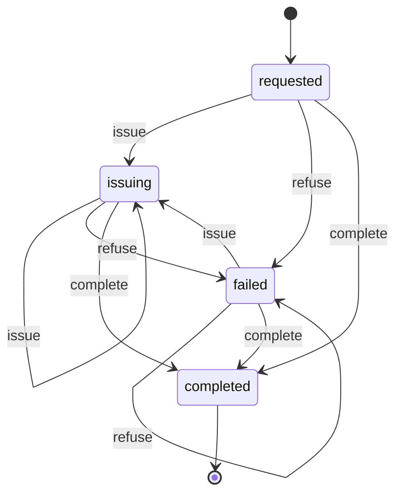

## project_refund_part

Table `project_refund_part`. Written by db/repositories/project-refunds.ts.

| Event | From | To |
| --- | --- | --- |
| `resend` | `pending`, `failed` | `pending` |
| `complete` | `pending`, `failed` | `completed` |
| `fail` | `pending`, `failed` | `failed` |

Final: `completed`.

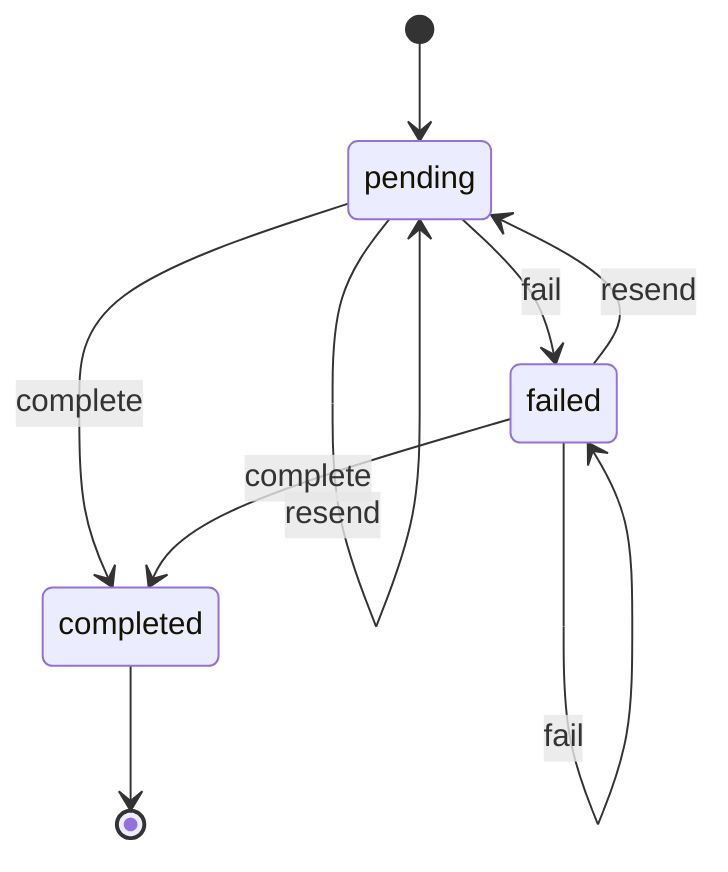

## quote

Table `quote`. Written by api/use-cases/projects.ts acceptQuote, acceptAmendment.

| Event | From | To |
| --- | --- | --- |
| `accept` | `proposed` | `accepted` |
| `supersede` | `proposed`, `accepted` | `superseded` |

Final: `superseded`.

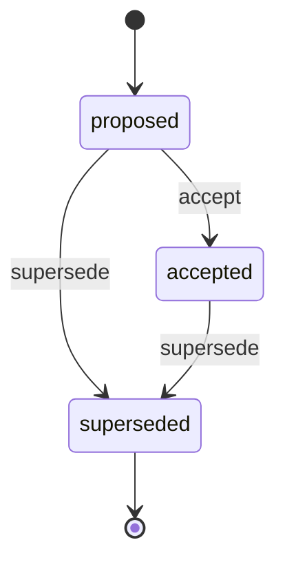

## amendment

Table `amendment`. Written by api/use-cases/projects.ts acceptAmendment, declineAmendment.

| Event | From | To |
| --- | --- | --- |
| `accept` | `pending` | `accepted` |
| `decline` | `pending` | `declined` |

Final: `accepted`, `declined`.

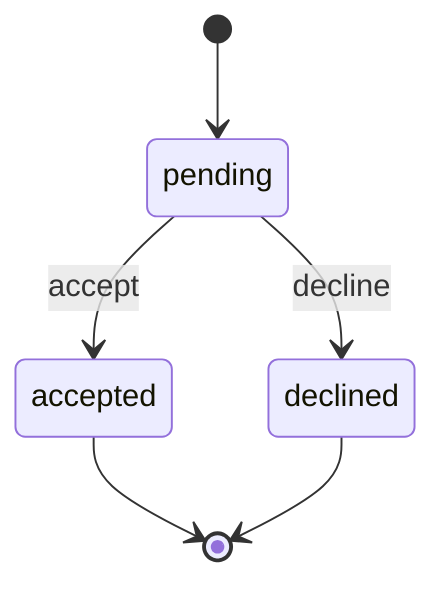

## delivery

Table `delivery`. Written by api/use-cases/projects.ts requestChanges, settleDelivery.

| Event | From | To |
| --- | --- | --- |
| `accept` | `submitted` | `accepted` |
| `request_changes` | `submitted` | `changes_requested` |

Final: `accepted`, `changes_requested`.

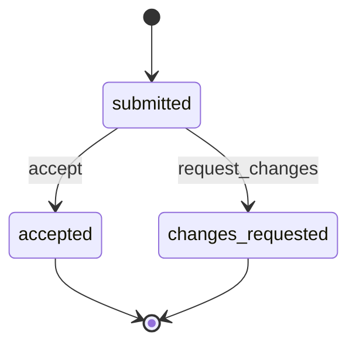

## order

Table `orders`. Written by db/repositories/orders.ts markOrderPaid, markOrderRefunded.

| Event | From | To |
| --- | --- | --- |
| `pay` | `pending` | `paid` |
| `refund` | `paid` | `refunded` |

Final: `refunded`.

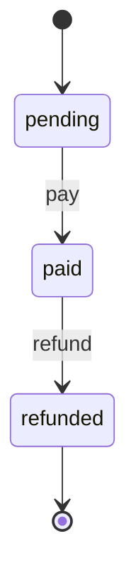

## dispute

Table `dispute`. Written by api/use-cases/disputes.ts applyDispute (disputeStatusAfter).

| Event | From | To |
| --- | --- | --- |
| `wait_for_seller` | `open`, `waiting_for_seller`, `under_review` | `waiting_for_seller` |
| `review` | `open`, `waiting_for_seller`, `under_review` | `under_review` |
| `resolve_for_seller` | `open`, `waiting_for_seller`, `under_review` | `resolved_seller` |
| `resolve_for_buyer` | `open`, `waiting_for_seller`, `under_review` | `resolved_buyer` |

Final: `resolved_buyer`, `resolved_seller`.

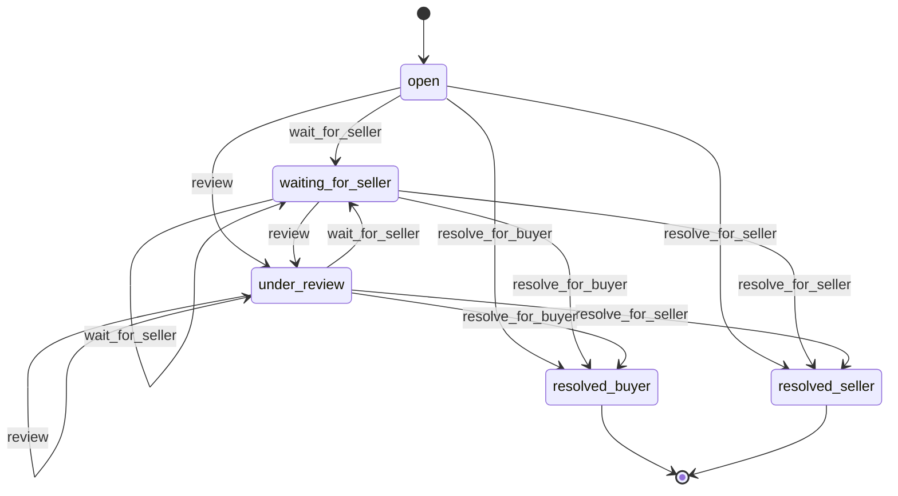

## agent_proposal

Table `agent_call_entry`. Written by db/repositories/calls.ts claimPendingProposal, recordProposalOutcome.

| Event | From | To |
| --- | --- | --- |
| `confirm` | `pending` | `done` |
| `decline` | `pending` | `declined` |
| `fail` | `done` | `failed` |

Final: `declined`, `failed`.

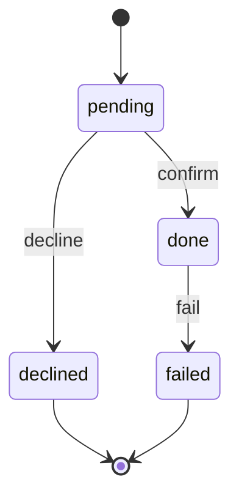

## paypal_webhook_event

Table `paypal_webhook_event`. Written by db/repositories/paypal-webhooks.ts.

| Event | From | To |
| --- | --- | --- |
| `process` | `received` | `processed` |
| `ignore` | `received` | `ignored` |
| `park` | `received` | `parked` |
| `fail` | `received` | `failed` |

Final: `processed`, `ignored`, `parked`, `failed`.

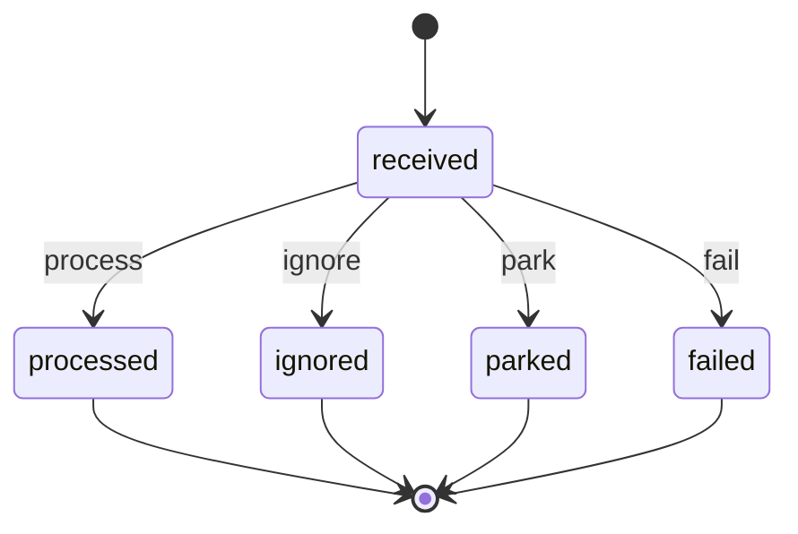

## paypal_onboarding

Table `paypal_onboarding`. Written by db/repositories/paypal-onboarding.ts (mirrors PayPal).

| Event | From | To |
| --- | --- | --- |
| `start_referral` | `pending`, `connected`, `needs_attention` | `pending` |
| `confirm_connected` | `pending`, `connected`, `needs_attention` | `connected` |
| `flag_needs_attention` | `pending`, `connected`, `needs_attention` | `needs_attention` |

Final: none.

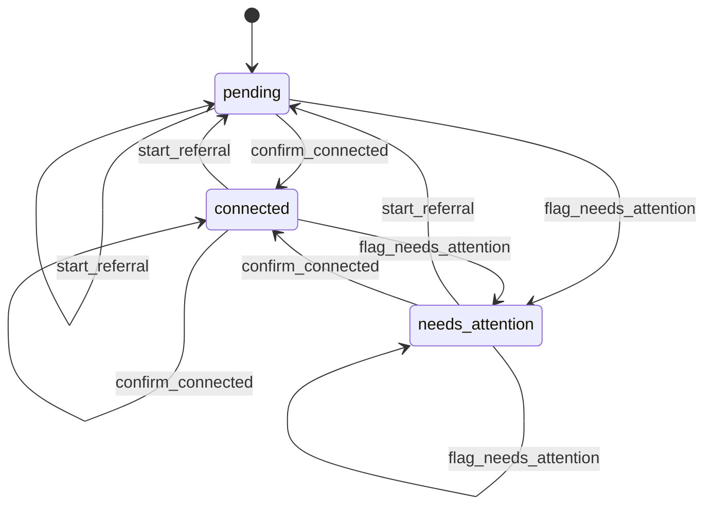

## seller_page

Table `team`. Written by db/repositories/stores.ts setTeamStatus.

| Event | From | To |
| --- | --- | --- |
| `publish` | `draft`, `active` | `active` |
| `unpublish` | `draft`, `active` | `draft` |

Final: `suspended`. Never entered: `suspended`.

```mermaid
stateDiagram-v2
  [*] --> draft
  draft --> active: publish
  active --> active: publish
  draft --> draft: unpublish
  active --> draft: unpublish
  note right of suspended: never entered
```

## product

Table `products`. Written by db/repositories/catalog.ts setProductStatus.

| Event | From | To |
| --- | --- | --- |
| `publish` | `draft`, `published` | `published` |
| `unpublish` | `draft`, `published` | `draft` |

Final: none.

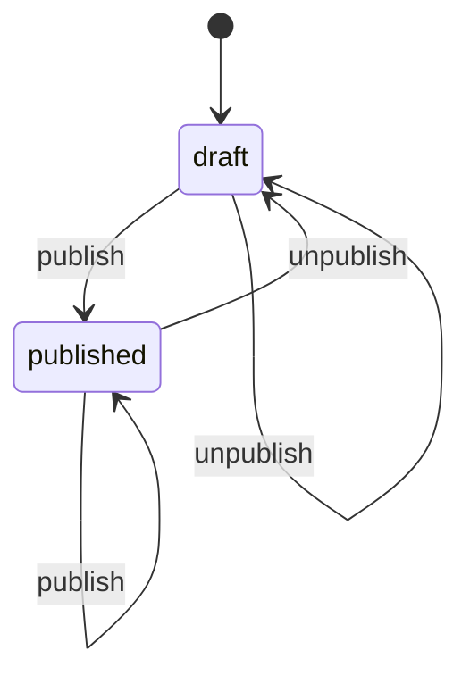

## rulebook

Table `rulebook`. Written by db/repositories/operating-model.ts saveRulebookDraft, publishRulebook.

| Event | From | To |
| --- | --- | --- |
| `edit` | `draft` | `draft` |
| `publish` | `draft` | `published` |

Final: `published`.

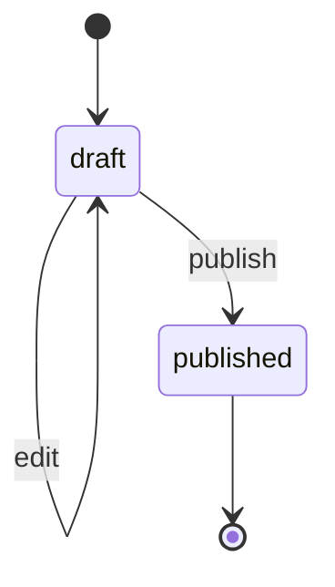

## schedule_item

Table `schedule_item`. Written by oss/engine-drizzle reconcile/complete/setSchedulePaused rows.

| Event | From | To |
| --- | --- | --- |
| `pause` | `pending`, `paused` | `paused` |
| `resume` | `pending`, `paused` | `pending` |
| `cancel` | `pending`, `paused` | `cancelled` |
| `fire` | `pending` | `done` |
| `fail` | `pending` | `failed` |

Final: `done`, `cancelled`, `failed`.

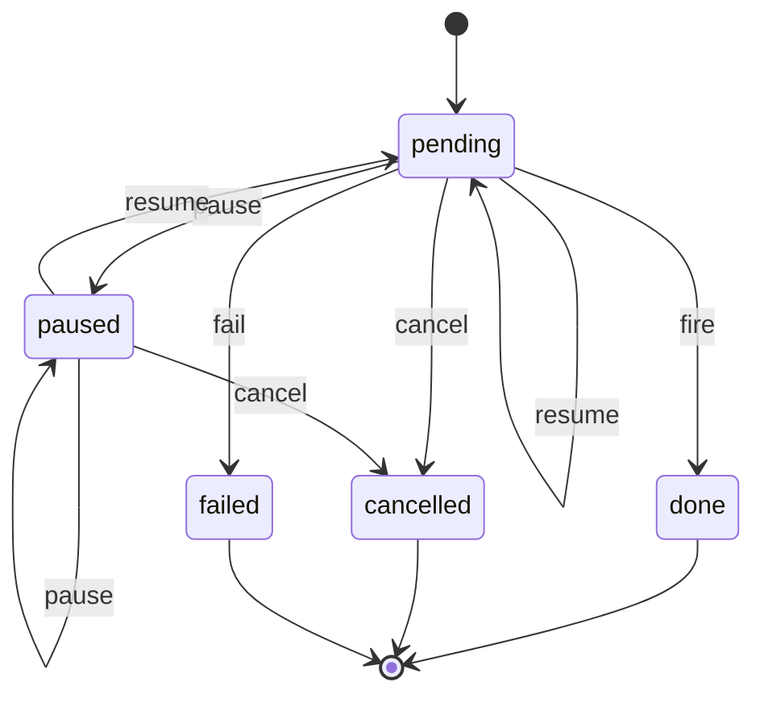

## outbox_delivery

Table `outbox_delivery`. Written by db/repositories/operating-model.ts applyDeliveryOutcome, skipOutboxDelivery.

| Event | From | To |
| --- | --- | --- |
| `send` | `pending` | `sent` |
| `retry` | `pending` | `pending` |
| `give_up` | `pending` | `failed` |
| `skip` | `pending` | `skipped` |

Final: `sent`, `failed`, `skipped`.

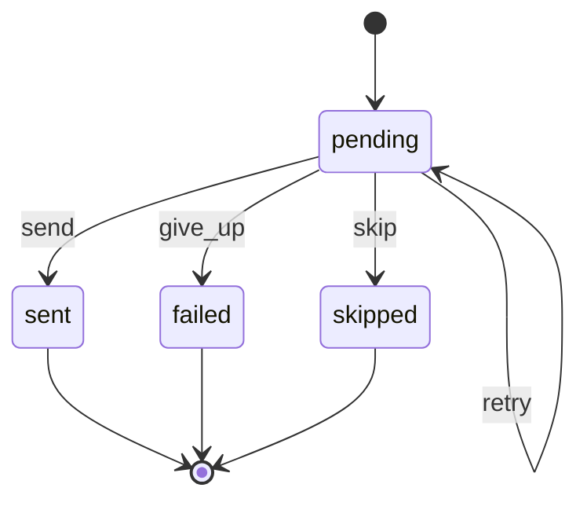

## billing (derived, not stored)

Owner: `packages/core/src/billing/entitlements.ts` (`entitlementsFor`). A workspace's billing state is computed on every read from its trial end and the Polar subscription mirrored on `billing_account` (`polar_status` copies Polar and is never set by the app). Only `lapsed` stops new sales: paid work, deliveries and refunds always complete.

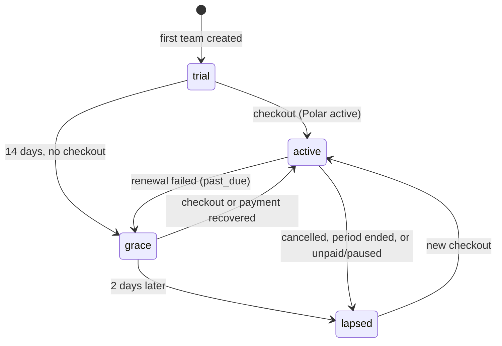

## Status columns without a machine here

- `project`: core projects/state-machine.ts (guards need facts beyond the status).
- `agent_call`: a thread stays open so its person can come back to it; `done` is kept for archiving, which is not built.
- `invitation`: Better Auth's organization plugin owns it.
- `store_domains`: no code writes it yet.
