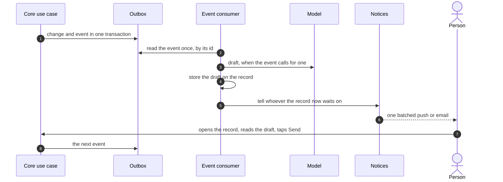
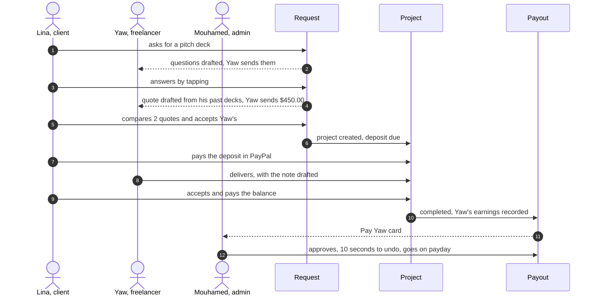

# The contextual dash

> **Current scope, 2026-10-28:** Resumed through [Calls and the agent](2026-10-27-calls-and-agent-design.md). The parked status below records Oct 18 history. The new design takes precedence for calls, team-defined handles and one agent with a changing environment; its schema/runtime/permission changes remain unbuilt.

**Date:** 2026-10-18. **Status: parked on 2026-10-18 by Mouhamed** ("we need to put aside the agentic dash and focus on revamping current screens and the plugin interfaces and widgets"). Kept as the reference for when the dash resumes; nothing here is planned. Before parking: revised the same day after Mouhamed's review ("aren't we overdoing this? in a plain CRUD app dash it would be pretty straightforward"; "yes do it"). The first draft modelled Payleor's work as sessions with their own tables, waits and routing; this version builds the dash on the records that already exist. Revised again the same evening: modes per section with rules (§8), the first prototype's record page and the second's sidebar for switching context. Awaiting Mouhamed's review. Choices marked *(call)* are Claude's and open to change.

**Amends** the agentic dash design ([`2026-10-16-agentic-dash-design.md`](2026-10-16-agentic-dash-design.md)) as listed in §11; its components (§4), push (§7), plugin (§8), failures (§11) and testing (§12) stand where §11 does not change them. **Builds on** conversations ([`2026-10-14-conversations-design.md`](2026-10-14-conversations-design.md)), the action registry ([`2026-10-13-action-catalog-design.md`](2026-10-13-action-catalog-design.md)) and the architecture reference ([`2026-10-16-architecture.md`](2026-10-16-architecture.md)). The clickable prototype is on the `brand-ds` branch (`.design-system/directions/payleor-dash.html`).

## 1. Intent

The dash is a CRUD dash over Payleor's records (requests, projects, payments, payouts, disputes) with four agentic parts:

1. **Payleor drafts the next step on the record:** the questions for a client, the quote, the delivery note, the dispute response. A person reads it and taps to send it.
2. **Events produce drafts and notices:** when Lina answers, Yaw's quote draft is ready and Yaw is told. Nothing in Payleor sleeps or wakes; the outbox consumer reacts to events.
3. **Needs you, a notification tray** behind a bell in the top bar, computed from the records' states: what waits on you, grouped by section (Mouhamed, 2026-10-18).
4. **A mode per section,** Manual, Ask me or Auto, so a team moves from doing the work itself to letting Payleor send what its rules allow, without the dash getting busier (§8).

Plus the ask box for questions, the first thing to cut if time runs short.

It is contextual because the same record looks different to each person: what they may see, what it waits on, and which buttons they get all follow from their workspace context (§4).

**Why records and not sessions:** every record already holds its state (`project.status`, payment and payout statuses), and who it waits on follows from that state. A parallel session model would duplicate the records and could disagree with them (Mouhamed, 2026-10-18).

**Goals**

- One vocabulary for code, specs, stories and screens (§2).
- For every record type: who it waits on in each state, what card each person sees, and what Payleor drafts (§5, §6).
- The build of runs G, C, L and D plans from this document.

**Non-goals:** the store context (later, same pattern); internal cases with templates (later, under Disputes); Discord and Slack (later, on the same events).

**Anti-goals** (a failure even if it works)

- A chatbot with a sidebar, where typing is the main way in.
- Jargon on screen: agent, session, tool, rule, prompt, action names.
- Money or a commitment moving without a person's tap.
- An answer drawing on data the person cannot see.
- A second source of truth beside the records.

## 2. Words

| In code and specs | On screen | Meaning |
|---|---|---|
| Payleor | Payleor | The assistant inside the dash; never "the AI" or "the agent" in copy |
| Workspace context | The workspace in the switcher, with the role under it | A workspace and the person's role in it (§4) |
| Section (`dashSections`) | Requests, Projects, Money… | A part of the dash, with its list page |
| Record | A request, a project, a payment, a payout, a dispute | A row the dash shows, with its own page |
| Waiting on (`waitingOn`) | "Waiting for Ama" | Who a record needs next, from its state |
| Needs you, In progress, Done | Needs you, In progress, Done | A record's place for one viewer, computed (§5) |
| Next step | Next step | The card on a record's page: what is needed, by whom, with Payleor's draft and the buttons |
| Draft (`draft`) | "Payleor drafted…" | Words or lines Payleor prepared for a person to send (§6) |
| Activity | Activity | Recent events across the workspace, on Home |

Copy rules from the screens review stand: sentence case, kinds as words, no eyebrows, no status dots, warm colours for trouble only.

## 3. Payleor's rules

1. **Reads only what the person may see,** in their current workspace context, never across contexts.
2. **Drafts; people commit.** A draft is never sent by itself. Sending it is the normal action (`quote.create`, `conversation.post`…) performed by the person who taps, through `perform`.
3. **Money.** Client payments leave for the pay page and PayPal's approval. A team payout waits 10 seconds with Undo after the tap (Mouhamed, 2026-10-17). Actions the registry marks `never` (refunds, roles, settings, connections) get no draft and no button from Payleor; the card links to the form *(call)*.
4. **The server builds every card.** The model writes words; amounts, names, dates and buttons come from the records.
5. **Untrusted text is data.** Briefs, messages, answers and dispute notes reach the model as data, never as instructions.
6. **Everything is recorded:** each action in the action log, each change as an outbox event on the record's timeline, each draft with its outcome (sent as is, edited, dismissed) as a label for a later classifier.
7. **Works without the model.** Every draft has a manual path: the form opens empty.
8. **Plain words** on screen (§2).

## 4. Workspace contexts

A workspace context is a workspace and the person's role in it. The switcher lists every context a person holds, each with its Needs-you count. The sections, what each record shows, the buttons and the notices all follow the current context.

| Context | Who | Comes from | Job |
|---|---|---|---|
| Team | Admins and managers of a services team | `services_team_member.role` admin or manager; organization owners and admins count as admins (`effectiveServicesTeamRole`) | Win and run paid work, keep clients paying, pay the team, handle trouble |
| Team of one | The owner of a solo seller | `services_team_settings.solo` | The same work with nobody to assign or pay: the owner keeps the whole price |
| Freelancer | Members with the freelancer role | `services_team_member.role` freelancer | Find work in the team, quote as themselves in open mode, deliver, get paid |
| Me | Anyone signed in, as a client | Verified client identities (A2) through `project_client` | Get work done and pay safely, with every team |

**Without a context:** a guest on `{slug}.payleor.app` builds a request with the concierge and lands in Me after signing in; a client link (`/c/{token}`) opens one project in the Me view; the plugin gives someone else's AI the same records (§9).

**Several contexts, one person** *(call)*: the dash opens on the last context used; the switcher shows each context's Needs-you count; a notice opens in its own context; a team member is never the client of their own team's project (A2).

### 4.1 What each context holds

| Context | Sections | Can see | Never sees |
|---|---|---|---|
| Team, admin | Home, Needs you, Requests, Projects, Money, Disputes, Shop, Settings | The team's offerings, requests and projects, client contacts, quotes in full, payments, refunds, the ledger, payouts and rules, members, disputes, both conversation spaces | |
| Team, manager | The same without Settings | The same, payouts read-only | Payout approvals, dispute responses, refunds, settings (`canServicesTeam`) |
| Team of one | Home, Needs you, Requests, Projects, Money, Disputes, Shop, Settings | Its own records; Money is money in and refunds | (no members, assignments or payouts) |
| Freelancer | Home, Needs you, Open requests, My work, Earnings | The requests the audience rule shows them (masked before acceptance), **how many quotes each has, and only their own quote in detail** (Mouhamed, 2026-10-18), their assigned projects and those projects' spaces, their own balance and payouts | Other freelancers' quotes and earnings, the team's money and settings, client contact details before acceptance |
| Me | Home, Needs you, My requests, My projects, Payments, Problems | Their requests and projects with every team, every quote they received, deliveries, payments and receipts, refunds, the cases they opened in PayPal | The team's internal messages, freelancers' earnings, other clients |

Yaw holds three contexts: a freelancer seat in Walk Crew, his own Yaw Studio, and Me. His switcher reads Walk Crew 3, Yaw Studio 2, Me 1, and a push about Esi's answers opens Yaw Studio on Esi's request.

## 5. Records and who they wait on

### 5.1 How a record's place is computed

- `waitingOn(record, facts)`, one pure function per record type in core, returns who the record needs next in its state: a role in the workspace, a person, the client, the eligible freelancers, or nobody (a time, PayPal).
- `needsYou(record, viewer)` gives the record's place for one viewer: **Needs you** when it waits on the viewer, or a role they hold, and they can act on it; **In progress** when it is open and waits on someone else; **Done** for 7 days after it closes *(call)*. One person acting clears it for everyone, from any surface.
- The Needs you tray, the counts in the sidebar and the switcher, Home, the plugin's `get_needs_you` and the notices all read these two functions.

### 5.2 Request

Source: `project` in `quoting`, `quote`, `conversation_message` and `request_shortlist` (C). The 48-hour clock starts at the request and stops at the team's first question, quote or decline (conversations §8).

| State | Waits on | Staff see | The freelancer sees | The client sees |
|---|---|---|---|---|
| New, nobody has answered | Staff; in open mode, the eligible freelancers | Payleor's questions draft (team and assigned modes); decline with a reason; shortlist | Open mode: "Start your bid", then Payleor's questions draft for them | "3 freelancers are looking at it" |
| Questions sent | The client | Waiting for the answers | Waiting for the answers | The questions, answered by tapping |
| Answered | Whoever quotes | Quote draft (team and assigned modes) | Quote draft from their own past work | Waiting |
| Quotes sent | The client | Every quote in full | "2 quotes sent, yours included": only their own in detail | One quote per slide, each with Accept |
| Accepted | Becomes a project with its deposit due | | | |
| Declined or expired | Nobody | | | The reason, and an offer to search again |

Staff are reminded at 24 hours; the request expires at 48 unless staff extended it once.

### 5.3 Project

Source: `project` (`awaiting_deposit` to `completed`, `cancelled`), `delivery`, `amendment`, `payment`.

| State | Waits on | The freelancer sees | The client sees | Staff see |
|---|---|---|---|---|
| Awaiting deposit | The client | Waiting for the deposit | Pay the deposit | The payment in Money |
| In progress | The freelancer, by the due date | Deliver: upload, with Payleor's note drafted | Waiting | Propose an amendment, drafted from a client's change request |
| Delivered | The client | Waiting for the review | Accept, or ask for changes with a note | Waiting |
| Awaiting balance | The client | Waiting | Pay the balance | The payment in Money |
| Completed | Nobody | Earnings recorded | Done | The payout in Money |

A pending amendment waits on the client; an accepted increase adds a top-up payment. A late delivery's penalty (`packages/core/src/projects/penalty.ts`) shows on the timeline; Payleor never proposes or waives one.

### 5.4 Payment

Source: `payment` (kinds `deposit`, `top_up`, `balance`; statuses `pending`, `captured`, `failed`, `cancelled`, `refunded`), `project_refund`.

- **Due or failed:** waits on the client, who pays from the card (the pay page, then PayPal's approval). Staff may send a new link (`project.client_link.email`).
- **Reminders:** 2 days after due, then weekly, three at most, with fixed wording and the pay link; the team can turn them off *(call)*.
- **Refund owed** (`refund.requested`): waits on an admin; the card opens the refund form, with no button from Payleor.

### 5.5 Payout

Source: `payout_request`, `payout_approval`, `team_payout_rules`, `payout_destination`.

- A member asks, or the sweep makes one for a completed project. The rules decide (auto-approve amount, trusted members, second approver, minimum): approved on its own, or waiting on admins.
- An admin taps Approve: 10 seconds to undo, then approved. It waits for payday, hold days and the balance floor, then goes to PayPal and settles. A failure retries, or waits on the member to connect PayPal (OUT-19).
- The freelancer's Earnings shows their own payouts; it needs them only to connect PayPal or when they can request one. A team of one has no payouts.
- Earnings are the final price less the team cut (15% by default); the client pays the management fee on top. One project has one freelancer, so the screens deck's split of one payout between two members is wrong; the dash prototype shows it right.

### 5.6 Dispute (run D)

Source: `paypal_dispute` *(new)*, kept from the verified `CUSTOMER.DISPUTE.*` webhooks.

- Opened, then evidence gathered by rule (the timeline, the acceptance, the deliveries, the messages), then the response drafted. It waits on admins until they send it in PayPal (Copy for PayPal, then "I sent it in PayPal"), then on PayPal; when lost, the ledger reverses.
- Managers read it; the client's Problems shows the case they opened; freelancers do not see it *(call)*.

### 5.7 Setup

Computed from the seller's and the member's own state, as ACC-11's checklist is today: PayPal connected, rates and quoting mode, a service, the page published, the bio; for a member, a payout destination and the age confirmation. It waits on admins or on the member. Payleor drafts the bio and service descriptions.

## 6. Drafts

| Draft | Made when | Made from | Sent with |
|---|---|---|---|
| Questions | A request arrives (team and assigned modes), or a freelancer starts a bid (open mode) | The brief and the offering's intake questions | `conversation.post` (question) |
| Quote | The answers are in, or nothing is left to ask | Similar past projects of the team or of the freelancer, and the quote calculator | `quote.create` |
| Delivery note | The freelancer uploads | The brief and the change requests | `delivery.submit` |
| Amendment | A client message reads as a change of scope | The message and the quote | `amendment.propose` |
| Dispute response | `dispute.opened` | The evidence | Copied into PayPal by an admin |
| Bio, service descriptions | Setup | The services and past projects | The settings forms |

- **One `draft` table** (G): `id`, `team_id`, `record_type`, `record_id`, `kind`, `for_user_id` or `for_role`, `body` (jsonb), `model`, `status` (`open`, `sent`, `edited`, `dismissed`), `created_at`, `decided_at` *(call)*. Sending a draft runs the normal action and marks the draft in the same transaction; the outcome is the label a later classifier trains on.
- **Each draft says what it was made from** ("Drafted from Kumasi Foods and Volta Water").
- **A draft built on an older version of the record** is refreshed, never sent.
- **Step kinds** stay as in the dash design §6.3: classify (offering, intent of a message), retrieve (similar projects), generate (wording, lines, the response).

## 7. Events

The outbox consumer (G) reads each event once, by its id, makes the drafts it calls for and tells the people the record now waits on. A cron fires the time rules.

| Event | Drafts | Who is told |
|---|---|---|
| `project.created` | Questions (team and assigned modes) | Staff; the eligible freelancers in open mode |
| `message.posted`, the client's answers *(C)* | Quote | Whoever quotes |
| `message.posted`, a client message after acceptance *(C)* | Amendment, when it reads as a change of scope | Staff |
| `quote.created` | | The client |
| `quote.accepted` | | The freelancer; the client, with the deposit due |
| `payment.captured`, `payment.failed` | | The freelancer when work starts; staff when a payment fails |
| `delivery.submitted`, `delivery.changes_requested` | | The client; the freelancer |
| `project.completed` | | The freelancer, with their earnings |
| `payout.requested` | | Admins |
| `payout.sent`, `payout.failed` | | The member |
| `dispute.opened` *(D)* | The response | Admins |
| Time rules (cron) | | The 24-hour request reminder and the 48-hour expiry, payment reminders, payday |

Notices are batched: at most one email and one web push every 15 minutes per project and person (dash design §5).

## 8. How much Payleor does

Each team chooses, section by section, how much Payleor does on its own (Mouhamed, 2026-10-18). The model is Claude Code's own: a mode decides what runs without asking, Shift+Tab switches it, and rules (allow, ask, deny) settle each kind of step, with deny beating ask and ask beating allow.

| Mode | What Payleor does |
|---|---|
| Manual | Answers questions; drafts nothing. The forms open empty |
| Ask me (the default) | Drafts the next step; a person sends it |
| Auto | Sends what the rules allow; everything else waits for a person, with the reason |

- **Where it is set:** in the ask box of every section and record (Shift+Tab cycles the three modes), and on the Payleor page, which lists every section's mode, the rules, and what ran on its own. The mode also shows as a chip in the sidebar and in the closed ask box.
- **Who sets it:** admins for the team's sections; a freelancer for their own Open requests and My work; the owner of a solo seller for everything. Clients have no modes: Payleor never accepts, pays or answers for a client.
- **Rules,** one per kind of step, each Allow (runs on its own in Auto), Ask (always waits) or Never. Locked rules cannot be changed.

| Section | Step | Default |
|---|---|---|
| Requests | Send questions on a new request | Allow |
| Requests | Send a quote within 10% of similar projects and under $1,000.00 | Allow |
| Requests | Send a quote outside that range | Ask |
| Requests | Decline a request | Ask |
| Projects | Send a delivery note; propose an amendment | Ask |
| Money | Send a payment reminder; send a new pay link after a failed payment | Allow |
| Money | Approve a payout | The payout rules decide (locked) |
| Money | Refund a client | Never (locked) |
| Disputes | Gather the evidence | Allow (locked) |
| Disputes | Send the response | Never: an admin sends it in PayPal (locked) |
| Shop | Update the page's text | Ask |
| Earnings (freelancer) | Request a payout | Never: only the member asks (locked) |

- **The check before each automatic step** (a classify step): the rule first; then anything the rule does not settle, or that looks unusual (a price far from past work, a client message that reads as a complaint), waits and says why: "Auto asked you: $1,200.00 is 14% above your Wedding teaser ($1,050.00), outside your 10% range." The check is code plus a Haiku classification with a strict run-or-ask schema; an error or any doubt means ask.
- **What people see:** a step that ran on its own is on the record's timeline with the rule that let it through ("Payleor sent Lina your 2 questions, on its own. Rule: send my questions on a request, Allow"), under "Done on its own" on the Payleor page, and in the catch-up on Home. Needs you holds only what waits on a person, so more autonomy means less in Needs you, not more.
- **In the registry:** a `confirm` action runs with Payleor as the actor, on behalf of the team's setting, only when its section is in Auto and its rule allows it; `never` actions never run. Each automatic run writes the action log with the agent as actor, the rule and the mode.

## 9. The dash

- **Sidebar, for switching context fast** (Mouhamed, 2026-10-18): a rail with the person's workspaces on top (one click switches, each with its Needs-you count), then Home and one tile per section with its count, and Payleor (modes and rules) at the bottom. Beside the rail, the chosen section's records under **Needs you**, **In progress** and **Done** (folded), with the section's mode as a chip; a record that changed list since the person last looked is highlighted once, and Search (⌘K) sits above the lists.
- **Needs you is a tray** (Mouhamed, 2026-10-18): a bell in the top bar with its count opens a short list of what waits on the person, grouped by section, each row opening its record. It is where notices land; email and push carry the same notices.
- **Home is an overview:** "While you were away" (events since the person's last visit), one card per section with its open records (what needs you first) and a link to the section, and Activity beside them.
- **Each section page is a dashboard built for its job,** not stacked full-width lists (Mouhamed, 2026-10-18): a row of totals, then
  - **Requests:** a board with one column per whose move it is (to answer, with the client, done this week); each card shows the client, the progress and the first-answer deadline;
  - **Projects:** a grid of cards with their progress, people, amount and due date;
  - **Money:** this month's totals, then "Coming in" and "Going out" side by side, then the latest payments (AG Grid Community in the build);
  - **Disputes:** case cards with the amount and the date the answer is due in PayPal;
  - **Shop:** what is left to set up, then the services.
  A card that needs the viewer is outlined in the brand colour and says "Needs you".
- **Record page** (as in the first prototype): **Where this stands** (what is needed, by whom, Payleor's draft with what it was made from, and the buttons; in Manual a note that nothing is drafted; in Auto, why it asked), the timeline (events, messages and what Payleor did on its own), and a side rail with the progress, details, people and **How Payleor worked this out**. On a phone the side rail sits behind a Details button.
- **Search (⌘K):** pages and records with breadcrumbs; a typed question goes to the ask box.
- **Ask box:** floats over every page and grows on focus; it reads what the person can see, starting from the page they are on, and answers in words with a server-built table when useful. On a section or a record it carries the mode switch (Manual, Ask me, Auto; Shift+Tab). Answering questions is first to cut; the mode switch stays.
- **Phone:** bottom tabs Home, Menu (the sections with their counts) and Search; the bell stays in the top bar.
- **The plugin:** the same records for someone else's AI; `get_needs_you` returns what waits on the person, and next steps render as widget cards; commitments stay widget-only (dash design §8).

From the Claude Code desktop idea this keeps the triage (Needs you, In progress, Done) in the sidebar, work that comes back to you when something happens (drafts and notices), the recap (Where this stands), the side rail and the modes. It does not build sessions, nested threads or side questions.

## 10. Data

- **New** (G unless marked): `draft` (§6); `push_subscription` (dash design §7); `workspace_visit` (`user_id`, `workspace_id`, `last_seen_at`) for "While you were away" *(call)*; `payleor_mode` (`team_id`, `user_id` for a freelancer's own sections, `section`, `mode`) and `payleor_rule` (`team_id`, `user_id`, `rule`, `decision`), with the defaults and locks in code; `paypal_dispute` (D). If Mouhamed wants questions kept, `ask_question` (`id`, `workspace_id`, `user_id`, `text`, `answer`, `created_at`) in C; otherwise answers are not stored.
- **Outbox events added:** `message.posted`, `request.declined`, `request.expired` (C); `dispute.opened`, `dispute.updated`, `dispute.resolved` (D).
- **Pure functions in core,** tested as tables: `workspaceContexts(person)`, `dashSections(context)`, `waitingOn` per record type, `needsYou(record, viewer)`.
- **Not built** (from this document's first draft): `agent_session`, `session_wait`, `session_entry`, `session_proposal`, `context_visit`, thread kinds, nested threads, side questions, a separate History journal, the five-layer scope stack.

## 11. What changes in the dash design

| Dash design (2026-10-16) | Now |
|---|---|
| §3 Team sections: Intake, Projects, Disputes, Payouts, Catalog, Insights, Settings | Requests, Projects, Money (payments in and payouts), Disputes, Shop, Settings; Insights' tables live on the section pages, its questions in the ask box |
| §3 Me: My projects, Payments, Disputes | My requests, My projects, Payments, Problems |
| §4 SessionPlan, SessionRecap | NextStep (the card) and Progress (the record's states) |
| §6.1 Sessions and triage (`agent_session`; Needs input, Working, Completed) | Who each record waits on (§5); Needs you, In progress and Done computed from the records |
| §6.2 Events wake sessions (`session_wait`, wake and start) | Events make drafts and notices (§7) |
| §6.2 Writes are proposals | Drafts (§6), sent by the normal action; in Auto, steps the rules allow run on their own (§8) |
| §6.4 A Durable Object per session | None needed for the first version: the ask box streams from the api Worker through AI Gateway *(call)* |
| §8 `get_sessions` in the plugin | `get_needs_you` |
| Conversations design §4: the request space shows eligible freelancers every quote | Freelancers see how many quotes were sent and only their own in detail; staff and the client see every quote (Mouhamed, 2026-10-18); `conversationAccess` returns quote details per viewer |

## 12. Placement before the freeze

| Run | Builds |
|---|---|
| G (Oct 20–22) | Contexts and the switcher; sections as dashboards; `waitingOn` and `needsYou`; the Needs you tray; Home; record pages with the Next step card, without drafts yet; the outbox consumer for notices; web push; the `draft` and `workspace_visit` tables |
| C (Oct 23–25) | Conversations; question and quote drafts with the model; the quote visibility rule; the ask box; the modes and rules, with Auto for questions and quotes |
| L (Oct 26–27) | The plugin on the same records: `get_needs_you`, next steps as widget cards |
| D (Oct 28–29) | Disputes with the drafted response; the payout approval card with undo; Auto for payment reminders and pay links; the Payleor page; AG Grid tables on the section pages |

**Cut order,** first to last: the ask box; the delivery note and amendment drafts; the dispute response draft (the evidence stays); web push (email stays). **Never cut:** the deploy, the Needs you tray, request drafts, the plugin's client flow, the pay page.

## 13. Stories

Story IDs are given when these are written into [`stories/`](../stories/README.md) while planning.

| Story | Covered today by |
|---|---|
| As anyone, the bell's tray lists what waits on me in this workspace, and the switcher counts the others | new |
| As Yaw, I switch between Walk Crew, my studio and Me, and each shows only its own work | new |
| As staff, a new request arrives with its questions drafted, and I send them with one tap | AGT-31; new for the draft |
| As a freelancer in open mode, Payleor drafts my questions and my quote from my own past work | new |
| As a freelancer, I see how many quotes a request has, and only my own | new |
| As a client, I answer by tapping and compare quotes one freelancer per slide | AGT-31, AGT-34 |
| As staff, a request I let sit reminds me at 24 hours and expires at 48 unless I extend it | AGT-37 |
| As a client, accepting a quote takes me to the deposit | QUO-13, PAY-01, PAY-02, AGT-12, AGT-13 |
| As a freelancer, my delivery note is drafted from the client's change requests | DEL-01, DEL-02; new for the draft |
| As a client, I accept a delivery or ask for changes, then pay the balance | DEL-04 to DEL-08, AGT-14 |
| As a client, a declined card tells me to pay again, and staff can send me a new link | PAY-07; new for the card |
| As an admin, a payout waiting on me shows the rule that applied, and I can undo my approval for 10 seconds | OUT-08, OUT-14 to OUT-16; new for the undo |
| As an admin, a PayPal case arrives with its evidence gathered and a drafted response to copy into PayPal | new (D) |
| As anyone, the ask box answers from what I can see, about the page I am on | AGT-28, widened |
| As anyone, when Payleor cannot draft, the form opens empty and I carry on | new |

## 14. Sequences

An event, a draft and a tap:

The full hire:

## 15. Testing

- **Tables in core:** `waitingOn` and `needsYou` for every record type, state and audience, Yaw's three contexts included; `dashSections` per context and role; the quote visibility rule.
- **Use cases with the real database:** an event makes the right draft and tells the right people once; sending a draft runs the normal action and marks the draft sent; a draft built on an older record version is refreshed, never sent; acting from the plugin clears Needs you on the dash.
- **Drafts with a scripted model:** fixed outputs become drafts; masked text stays masked.

## 16. Calls to check

1. One `draft` table for every kind of draft, its outcome kept as a training label.
2. `never` actions get no draft and no button.
3. Payment reminders go out on their own; the team can turn them off.
4. Money holds payments in and payouts; Insights folds into the section pages and the ask box.
5. The ask box needs no Durable Object in the first version.
6. `workspace_visit` for "While you were away".
7. Done keeps a record for 7 days.
8. Freelancers do not see disputes.
9. Every section starts in Ask me; Auto's quote range is 10% of similar projects with a $1,000.00 ceiling, both editable.
10. Admins set the team's modes, freelancers their own sections, a solo owner everything; clients have none.
