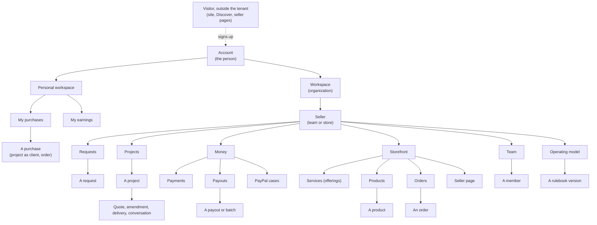

# Context graph: inventory and agent environment per node

**Date:** 2026-10-28. **Status:** draft for Mouhamed's review. Step 1 and 2 of three: (1) list every screen as a node in the context tree, from the tenant down; (2) infer the agent's environment at each node (context, tools, skills); (3) design the dash from that graph. Step 3 is not started; it waits for this graph to be agreed.

**Sources:** the stories in `stories/` (every actor and surface), the dash routes in `apps/web/src/app/dash/`, the action registry in `packages/api/src/actions/`, the tRPC routers in `packages/api/src/routers/`, the levels in [calls and agent §2](2026-10-27-calls-and-agent-design.md) and the vocabulary in [the use-case review §3.1](2026-10-28-contextual-agent-use-cases-review.md). Facts about today's code are marked **today**; everything else is proposed.

## 1. The tree

One agent, Payleor. Where it stands in this tree decides what it sees, what it may do and which playbooks it loads. Moving through the dash moves it through the tree; bringing in a record widens it to the lowest node that holds everything on the table.

Outside the dash, the same nodes are reached from the client's AI plugin (`api.payleor.com/mcp`), the client and pay pages on `{team}.payleor.app`, and later chat channels. Those surfaces see the client's side of the same records.

## 2. Inventory: nodes and today's screens

| Node | Today's screens (routes under `dash/`) | Records | Who reaches it |
|---|---|---|---|
| Account | `/` (picks a workspace), `account`, `new`, `new/services-team`, `oauth/consent` | The person, their workspaces, connected apps | The signed-in person |
| Personal workspace | none as such **today**; `me/*` stands in | Their own client projects, payouts to them | The person only |
| My purchases | `me/projects` | Projects where they are a verified client; store orders are link-only **today** | The person through verified client relationships |
| My earnings | `me/payouts` | Payouts owed and sent to them across teams | The person as payee |
| Workspace | none **today**: a workspace's teams are listed on `/` | Organization, memberships | Owner and admins |
| Seller | `[storeSlug]` (Overview), `settings`, `preview`, `discord` (server link, to become the agent's channel setting) | The team or store, its settings and integrations | Members by role |
| Requests | `[storeSlug]/requests` | Open requests, shortlists, request conversations | Admins, managers, freelancers in the department |
| A request | inside `requests`, and `projects/[projectId]` once quoting | Brief, questions, quotes in competition | Same, plus the client from their side |
| Projects | `[storeSlug]/projects`, `projects/new` | Projects with status | Members by role and assignment |
| A project | `[storeSlug]/projects/[projectId]` | Quote, amendments, deliveries, files, conversation, clients, refunds, marks, dispute | Admins, the assigned freelancer, the manager; the client from their side |
| Money: payments | none on its own **today**; inside projects and orders | Captures, refunds, fees | Admins |
| Money: payouts | `[storeSlug]/payouts`, `payouts/rules` | Payout requests, batches, rules, PayPal credentials, Payouts Web exports | Admins; members see their own |
| Money: PayPal cases | none on its own **today**; dispute card on a project | Disputes and their timers | Admins |
| Storefront: services | `[storeSlug]/services`, `services/new`, `services/[offeringId]` | Departments, offerings, intake questions | Admins |
| Storefront: products | `[storeSlug]/products`, `products/new`, `products/[productId]` | Products, variants, digital files | Admins |
| Storefront: orders | `[storeSlug]/orders` | Store orders, download grants | Admins |
| Storefront: seller page | `preview`, and the public page | Bio, listing, publish state | Admins |
| Team | `[storeSlug]/members` | Members, roles, titles, departments, marks | Admins; members see themselves |
| Operating model | `[storeSlug]/rules` | Rulebook drafts and versions, member agreement, notice preferences | Admins edit; members accept |

### 2.1 The same nodes on every surface

The dash is one surface. The stories (`stories/`, 196 of them) reach the same nodes from the seller site, the client's AI plugin and email. **Discord as a product surface is dropped** (run E cancelled, Mouhamed 2026-10-28): Discord, like Slack, is only a channel the agent can talk through (calls and agent §8, Chat SDK). A channel adds no node and no tool: it carries the calls of whatever node the agent stands on, so it has no column here. The DIS stories and Discord sign-in stay as built, outside this graph. A node's environment does not change with the surface; what changes is who stands there (the team, a client, a buyer, a visitor) and which of the node's tools that side may use.

| Node | Dash | Seller site (`{seller}`) | Client's AI plugin | Email | Stories |
|---|---|---|---|---|---|
| Account | home, account, sign-up and log-in, consent | | OAuth consent | verification, reset | ACC-04–10, DIS-01–02, AGT-09 |
| My purchases (client) | `me/projects` | client page `c/<token>`, pay page | search, request, quote, delivery and pay widgets | client notices | QUO-01–03, QUO-13, PAY-01–13, DEL-04–09, AGT-09–16, AGT-31–36, AGT-61 |
| My purchases (buyer) | none **today** (link-only orders) | checkout, order page | cart and checkout (cancelled with M) | download email | STO-06–11, STO-15–16, AGT-63 |
| My earnings | `me/payouts` | | | payout notices | OUT-01–03, OUT-07, OUT-14, OUT-23, OUT-28, DIS-06 |
| Workspace | `/` lists sellers | | | | ACC-10, AGT-55, AGT-62 |
| Seller | Overview checklist, settings, preview, Discord | public seller page, policies | offering cards | | ACC-08–14, CAT-05–11, STO-01, STO-05, STO-14, DIS-03–05 |
| Requests, a request | requests, project page while quoting | request form | request and questions | new request, expiry | QUO-01–09, AGT-11, AGT-26, AGT-31–34, AGT-37 |
| Projects, a project | projects, project page | client page | quote and delivery widgets | project notices | QUO-10–16, DEL-01–11, AGT-01–06, AGT-47–54 |
| Money: payments | inside projects | pay page | pay from widget | receipts | PAY-01–16, DEL-08–11 |
| Money: payouts | payouts, payout rules | | | | OUT-04–27, OUT-29, AGT-56–58 |
| Money: PayPal cases | dispute card on a project | | | dispute notices | AGT-54 |
| Storefront | services, products, orders, preview | seller page, store section, checkout | offering search | | CAT-01–04, STO-01–17, AGT-19 |
| Team, a member | members | | | member notices | ACC-15–16, AGT-47, AGT-51 |
| Operating model | rules | rule summary on client and pay pages | terms before a request | | AGT-46–53 |
| Outside the tenant | | `{site}` pages, Discover | | | ACC-01–03 |

The contextual agent's own stories (AGT-26, AGT-28, AGT-55–63, "D: one contextual agent" and "Contextual agent: planned walkthroughs" in `stories/09-agentic.md`) test this graph directly: AGT-55 the environment following the context, AGT-61 a customer with no seller working from My purchases, AGT-62 one consultant who buys, sells and works in three contexts, AGT-63 a store order exception seen by both sides.

### 2.2 What the web app has today, node by node

From `apps/web/src/app` on B1 (`00ad399`). Three apps share one Worker, picked by host (`lib/host-routing.ts`): the site (`(site)/`), the dash (`dash/`, on `dash.`) and the seller site (`store/`, rewritten from `{team}.payleor.app`). There is **no agent, chat, call or "needs you" surface anywhere** in the web app today; the agent exists only as the client's AI plugin on the API.

| Node | There | Not there |
|---|---|---|
| Visitor | Site: home, pricing, network, Discover, visibility, audience pages (freelancers, agencies, stores, studios), contact, blog, legal, `llms.txt`, sitemap, robots | Discover lists sample listings, not the network's search (run V) |
| Account | Sign-up, log-in (email, PayPal, Discord), verify, reset, `account` (profile, linked Discord), OAuth consent, user menu | Any summary of what needs the person across workspaces |
| Personal workspace | Nothing as a place. `me/projects` ("Your projects", client home across teams) and `me/payouts` (payout destination, request, history) are reached from links | A personal home; store orders for a signed-in buyer (orders are link-only); subscription and workspace type |
| Workspace | `/` "Your workspace": each organization with its stores and services teams, status and role; create a store or a team | Anything inside the workspace above one seller: totals, members across sellers, calls |
| Seller | `[slug]` Overview: setup checklist, PayPal connect card, publish card, store toggle; `settings`, `preview`, `discord`. The shell has a flat nav of eleven items split into "work" and "team", and a breadcrumb | What needs attention, counts per section, activity; a store and a services team are two seller kinds with two dashboards (`StoreDashboard`, `ServicesTeamDashboard`) |
| Requests | `requests` "Open requests" list | Deadline from the pinned schedule (fixed 48 h, backlog), intake drafts |
| A project | `projects/[id]`: one long page (`project-detail.tsx`, 30k) with progress, quote calculator, price adjustments, clients, conversation, refunds, member marks, dispute card, in-page section nav | The lifecycle with "what can happen now" from declared states; the agent's preparation |
| Money | `payouts`: credentials card, requests table, Payouts Web export and import; `payouts/rules` | Payments and PayPal cases as their own pages; a batch as an object; the ledger |
| Storefront | `services` (departments and offerings), `products` (with lookup from a URL or a photo), `orders`; seller site: seller page with offerings and store section, request form, product checkout (`store/buy`), order page, policies | Ratings, reviews and portfolio (run P); the mall (cancelled with M) |
| Client side of a project | Seller site: client page `c/<token>` and pay page `pay/<token>` (`client-project-view.tsx`); the same two also on the platform host under `(site)/(docs)` | |
| Team | `members`: members, roles, titles, departments | Marks and agreements per member as a record page |
| Operating model | `rules`: editor, presets, publish, member agreement, notice preference, leaving notice | Which records are pinned to which version |

What this adds to the graph:

- **The web app is organised by seller, not by context.** Everything below `/` hangs off `[slug]`, and the store and the services team are two dashboards rather than capabilities of one seller.
- **The upper nodes exist only as lists or links:** `/` lists sellers, `me/*` are two pages without a home. The account, personal workspace and workspace nodes have no environment to stand in.
- **The richest node is one page.** A project is a single 30k component holding every section; in the graph it is a record node with child records (quote, amendment, delivery, conversation, refund, dispute), each of which the agent will act on separately.
- **The client side of a node is a separate app.** The client page and pay page (`client-project-view.tsx`) are the client's view of the same project node; the plugin is a third view of it. The agent's client-side environment is the same node seen from that side, not a new set of pages.

### 2.3 Gaps the backlog already names on this graph

From `BACKLOG.md`, owner "Contextual agent prerequisite" and related rows:

- **Read projection:** project responses return rival quote details to worker-facing callers; the agent must read only authorized fields (node: a request).
- **Action interface:** payout decisions, retries and exports use router checks outside `perform` (node: payouts). Same finding as §4.1 below.
- **Deadline projection:** the open-request deadline shows a fixed 48 hours, not the pinned schedule (node: a request).
- **Conversation access:** `abandoned` projects are missing from conversation closure checks (node: a project).
- **Execution contract:** an approval does not prove the approver still has authority at send time (node: a payout or batch).
- **Authorization design:** reconcile the account and workspace scope graph and team-defined handles with today's fixed roles and `perform` scope (every node).

What the inventory shows:

- **The top of the tree has no screens.** Account, personal workspace and workspace exist in the data but the dash starts at a seller. The agent's widest contexts have nowhere to live.
- **Money is split across places.** Payments and PayPal cases have no node of their own; they surface inside projects and orders.
- **The seller nav is flat.** Eleven items sit side by side (`team-shell.tsx`), mixing sections (Projects), records views (Orders) and configuration (Rules, Settings, Discord, which becomes a channel setting).

## 3. The environment at each node

For each node: **Context** is what Payleor loads before it answers; **Tools** are what it can call, with today's agent policy (`free`, `confirm`, `never`); **Skills** are the playbooks it needs there: the domain knowledge and steps for that kind of work, loaded only at that node. **Opens calls** names the events that reach a person from this node.

Tool names in `code` are registry actions (`packages/api/src/actions/`), which go through `perform` with grants, actors and the action log. Names in *italics* are tRPC procedures only **today**: the agent cannot use them until they become registry actions.

### Account

- **Context:** the person, their workspaces with one-line summaries (what needs them, money owed to them), connected apps. Never inside a workspace.
- **Tools:** switch or open a workspace; *create a workspace or team*; read connected apps. No record actions.
- **Skills:** orientation ("what needs me today across everything"), workspace setup.
- **Opens calls:** none; it lists calls from below.

### Personal workspace: My purchases and My earnings

- **Context:** the person's verified client projects across teams; payouts owed and sent to them.
- **Tools:** `project.get` (client side), `quote.accept`, `amendment.accept`, `amendment.decline`, `delivery.accept`, `conversation.post`, `conversation.answer`, *request changes*, *pay start* (opens PayPal; a person pays); *payout destination get and connect*.
- **Skills:** hiring and paying as a client (the plugin's flow); reading a quote and its terms; checking an earning's hold and payday.
- **Opens calls:** a quote arrived, a delivery is ready, a question from the team, a payout sent or held.
- **Gate:** accepting and paying always need the person's press; the agent prepares.

### Workspace

- **Context:** the organization, its sellers with summaries, members across sellers.
- **Tools:** none in the registry **today**; *list teams*, *create team*.
- **Skills:** comparing sellers' money and load; adding a seller.
- **Opens calls:** none of its own; rolls up its sellers' calls.

### Seller (team or store)

- **Context:** settings, enabled capabilities (services, store, payouts), chat channels connected for the agent, the current operating model version, counts per section.
- **Tools:** *update settings*, *update bio*, *enable store*, *switch to team*, *connect a chat channel* (today *Discord link code*), *seller publish and unpublish*, *PayPal onboarding*.
- **Skills:** explaining what the team's operating model does; setup checklists (PayPal connected, page published, rules accepted).
- **Opens calls:** setup incomplete, PayPal onboarding needed.

### Requests and a request

- **Context:** open requests with their brief, intake answers, deadline from the pinned rulebook, shortlist, competing quotes (each freelancer sees their own).
- **Tools:** `conversation.post` (ask the client a question), `quote.create`, `request.shortlist`, `request.decline` (`never` for the agent), `member.departments`.
- **Skills:** intake triage (is it in scope, which department, who should quote); drafting questions; drafting a quote from the offering's price range and days (the person sends it).
- **Opens calls:** new request for the department's handle (`@sales`); answer window closing; client answered.

### Projects and a project

- **Context:** the project, its status and lifecycle, quote and amendments, deliveries, conversation, clients, the pinned rulebook version, dispute, marks; one link away: the client, the assigned member, payments.
- **Tools:** `project.get`, `project.list`, `project.start`, `project.assign` (`never`), `amendment.propose`, `delivery.submit`, `conversation.post`, `project.client.add`, `project.client.remove`, `project.warning.record` (`never`); *offer paid revision*, *refund client*, *decide late refund*, *set quality refund*, *client link email and reissue*, *delivery file URL*.
- **Skills:** reading the lifecycle and saying what it waits on; reminders and extensions under the rulebook; late and quality refund rules with their caps; dispute handling (what PayPal needs, which timers paused).
- **Opens calls:** delivery overdue, client silent past the reminder, changes requested, dispute opened, late refund to confirm.
- **Gate:** refunds and anything that moves money are confirmed by an admin.

### Money: payments, payouts, PayPal cases

- **Context:** captures and refunds; payout requests, the batch, payout rules (auto-approve limit, second approver, hold days, payday, floor), the team balance; open disputes and their deadlines.
- **Tools:** none in the registry **today**. All are procedures: *payout request*, *list*, *approve*, *reject*, *retry*, *refresh*, *save rules*, *apply preset*, *export and import Payouts Web*, *connect credentials*.
- **Skills:** payout review (released earnings, destination changes, open cases, shares against quotes), batching on payday, explaining a hold, dispute response.
- **Opens calls:** payout requested (`@payouts`), second approval needed, payout failed, destination changed, dispute opened.
- **Gate:** sending money needs a person, or an Auto rule the team chose and PayPal allows.

### Storefront: services, products, orders, seller page

- **Context:** departments and offerings with intake questions; products, variants, stock, digital files; orders and download grants; the page's publish state.
- **Tools:** `offering.search` (`free`, the public side); procedures: *create, update, activate and delete offerings*, *departments*, *catalog create, update, publish*, *lookup from URL and photo*, *prefill from match*, *market price*, *order resend link*, *seller preview and publish*.
- **Skills:** writing an offering (scope, price range, days, intake questions); listing a product from a link or a photo (the lookup tools exist **today**); pricing against the market; order support.
- **Opens calls:** an order email failed, stock ran out, an offering has no department.

### Team and a member

- **Context:** members, roles, titles, departments, marks and strikes, leaving notices, agreement acceptance; a member's own earnings are visible only to them and admins.
- **Tools:** `member.departments`; procedures: *add member*, *set role*, *set title*, *set departments*.
- **Skills:** onboarding a member (agreement, departments, payout destination); explaining marks and the strike rule.
- **Opens calls:** member agreement pending, a third mark, leaving notice given.
- **Gate:** role changes stay with an admin.

### Operating model and a rulebook version

- **Context:** the draft, published versions and what each record is pinned to; the presets (solo, agency, collective).
- **Tools:** procedures only: *save draft*, *publish*, *apply preset*, *accept member agreement*, *notice preference*, *leaving notice*.
- **Skills:** explaining a rule in plain words and its effect on open work ("projects started before v4 keep v3"); comparing presets; drafting a change for an admin to publish.
- **Opens calls:** a draft waiting to publish, members who have not accepted the current version.
- **Gate:** publishing stays with an admin.

## 4. What the graph tells us

1. **The agent can act at only part of the tree.** The registry covers requests, quotes, projects, deliveries, clients and conversations. Money, the storefront, the team and the operating model are tRPC procedures the agent cannot reach. Moving the actions the demo touches (payout approve, reject, batch) into the registry comes first.
2. **Tools are not tied to states yet.** No action declares the statuses it fires from, so "what can happen now" at a record cannot be listed without running guards (calls and agent §11). The graph needs `from` on each action to give each record node its live tool list.
3. **Skills follow the nodes, not the screens.** About a dozen playbooks cover the tree: orientation, client hiring, intake triage, quote drafting, project lifecycle, refunds and disputes, payout review, product listing, offering writing, member onboarding, operating model explanation, setup. Each loads only at its node and below.
4. **The top three levels need screens.** Account, personal workspace and workspace are where the agent's widest view lives (what needs me across everything) and where a client's purchases belong.
5. **Money wants its own node** with payments, payouts and cases together, matching the calls design's sections.

## 5. Next: the design from the graph

Not written yet. Questions to settle on this graph first:

1. Is the tree right: account, personal workspace and workspace above the seller, with six sections under it (Requests, Projects, Money, Storefront, Team, Operating model)?
2. Does Operating model sit beside the sections, or under the seller's settings?
3. Which skills are in scope before Nov 4: payout review, intake triage and project lifecycle (the demo's three), or more?
4. Which procedures move into the registry for the demo: payouts first?

Then the design takes each node and gives it one screen shape (list, record, or summary), its right-panel context, its tool list and its calls, from this table rather than from the mockups.
